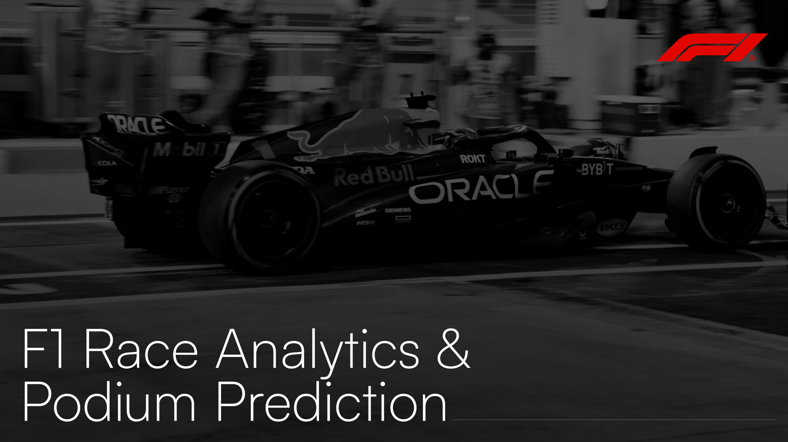
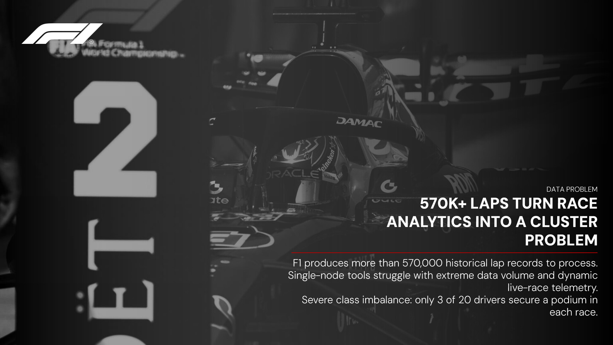
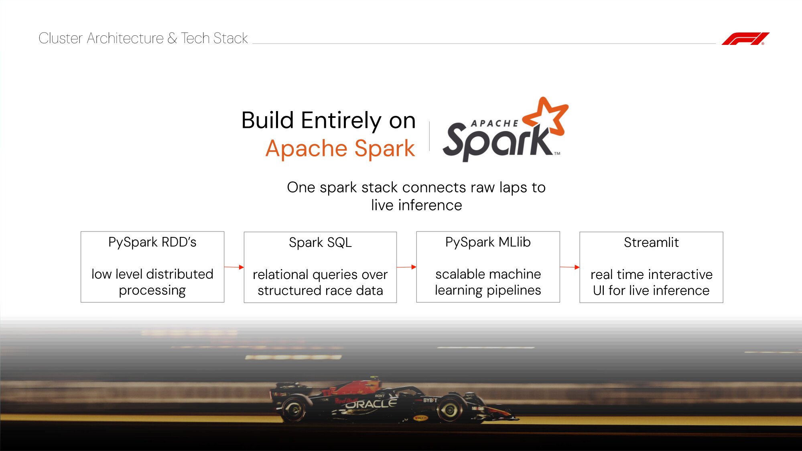
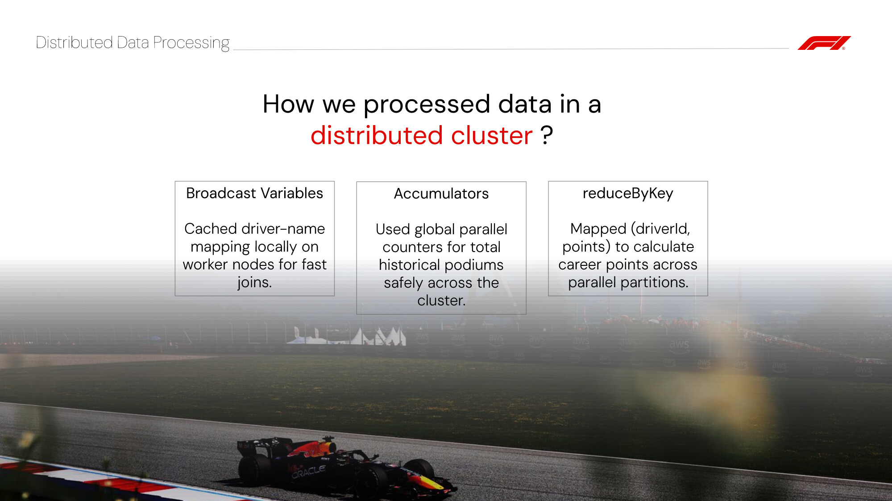
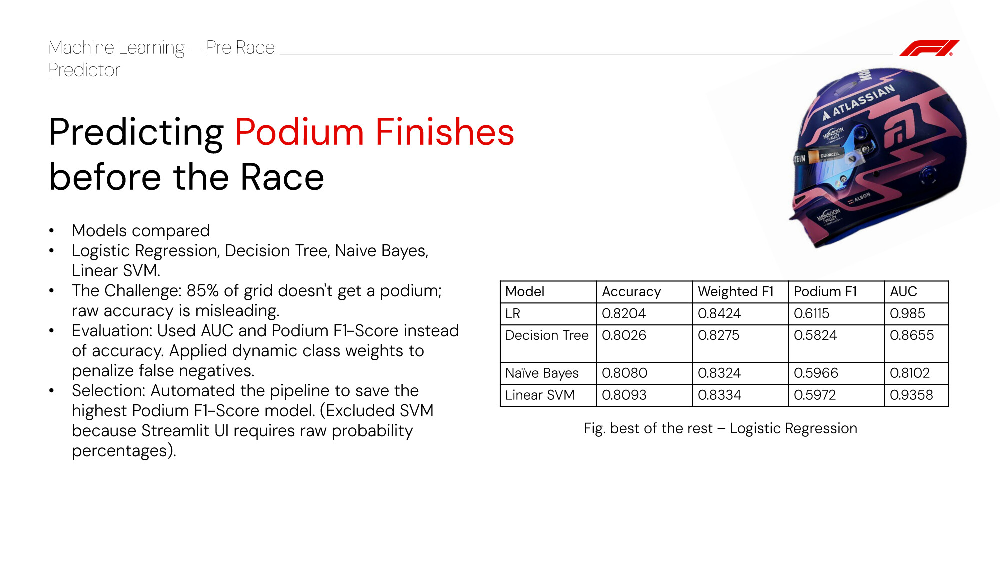
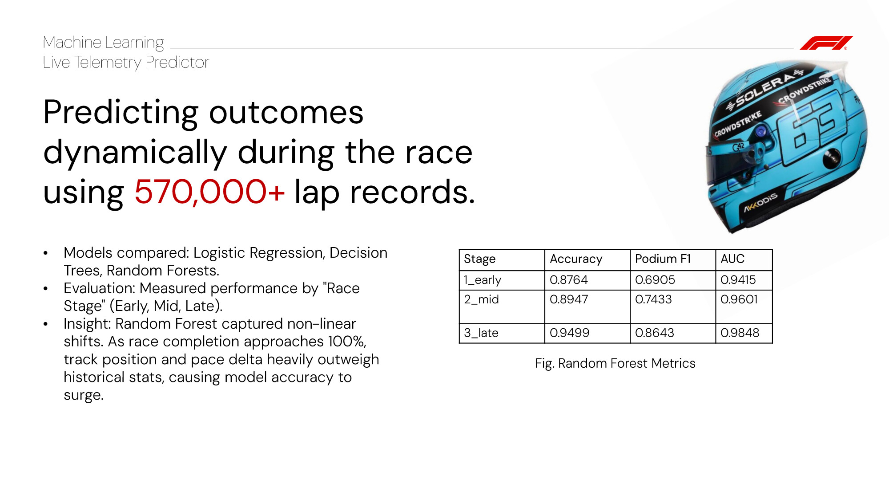
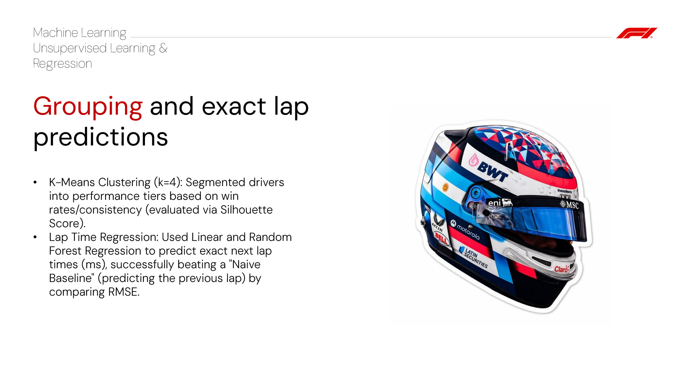
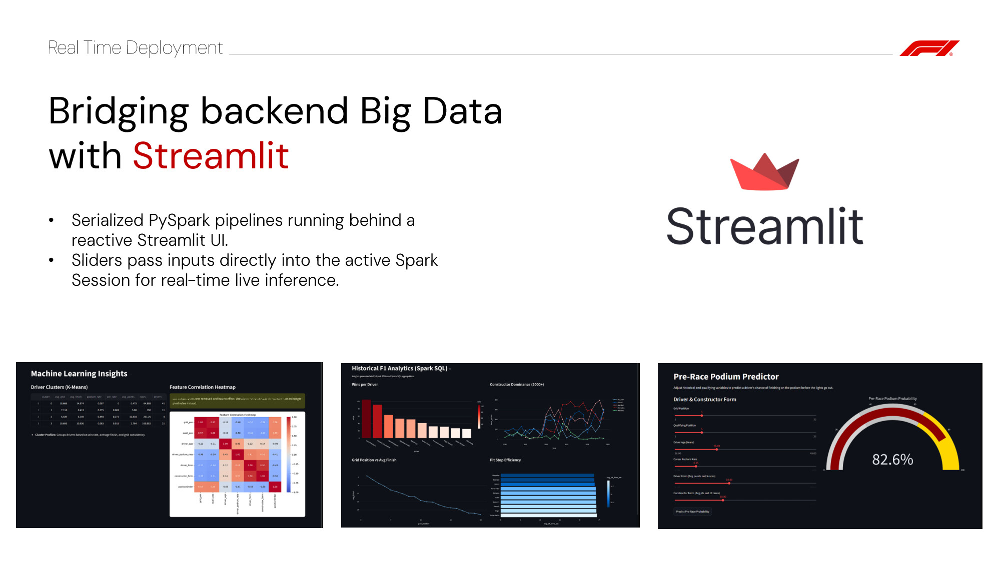

# F1 Race Analytics and Podium Prediction using PySpark 🏎️

This project implements a distributed machine learning and data analytics pipeline to analyze historical Formula 1 data and predict race outcomes. It leverages Apache Spark (PySpark) to handle large-scale data processing and model training, and includes an interactive Streamlit dashboard for real-time race simulation.

## Slides

Because I made them!










## 🚀 Features
* **Distributed Analytics:** Uses PySpark RDDs and Spark SQL to process decades of F1 data (drivers, constructors, pit stops).
* **Pre-Race Predictor:** Spark MLlib classification models (Logistic Regression, Decision Trees) predicting podium finishes based on historical form and qualifying data.
* **Live Lap Telemetry Simulator:** Dynamic modeling trained on over 570,000 lap records to predict podium probabilities mid-race based on track position and pace delta.
* **Driver Clustering:** K-Means algorithm categorizing drivers into distinct performance tiers.
* **Interactive Dashboard:** A Streamlit frontend wrapped to run within the Spark JVM for lightning-fast model inference.

## 📂 Project Structure
* `common.py` - Core configuration, PySpark session initialization, and data loading.
* `01_rdd_sql.py` - RDD transformations and Spark SQL aggregations.
* `02_ml.py` - Pre-race feature engineering and model training.
* `03_ml.py` - Live telemetry processing and lap-time regression.
* `app.py` - The interactive Streamlit web dashboard.
* `run_app.py` - Py4J execution wrapper for launching Streamlit via Spark.
* `data/` - (Ignored in Git) Directory for the Ergast F1 CSV dataset.
* `output/` - (Ignored in Git) Directory for serialized models, metrics, and generated charts.

## ⚙️ Prerequisites
* **Java 1.8** (Required for Hadoop/Spark backend)
* **Apache Spark** (Configured in system PATH)
* **Python 3.x**

## 🛠️ Setup & Installation
1. Clone this repository:
   ```bash
   git clone <your-repo-url>
   cd f1_project
   ```
2. Create and activate a virtual environment:
   ```bash
   python -m venv .venv
   # Windows:
   .venv\Scripts\activate
   # Mac/Linux:
   source .venv/bin/activate
   ```
3. Install the required Python packages:
   ```bash
   pip install pyspark pandas matplotlib seaborn plotly streamlit
   ```
4. Download the [Formula 1 dataset from Kaggle](https://www.kaggle.com/rohanrao/formula-1-world-championship-1950-2020) and extract the CSV files into a folder named `data/` in the root of the project.

## 🏃‍♂️ How to Run

Execute the pipelines in the following order using `spark-submit`. 

**1. Generate SQL Analytics & RDDs:**
```bash
spark-submit 01_rdd_sql.py
```

**2. Train Pre-Race Machine Learning Models:**
```bash
spark-submit 02_ml.py
```

**3. Train Live Telemetry & Lap Models:**
```bash
spark-submit 03_ml.py
```

**4. Launch the Interactive Dashboard:**
*(Note: Streamlit is launched via the `run_app.py` wrapper to maintain the Spark Java environment)*
```bash
spark-submit run_app.py
```